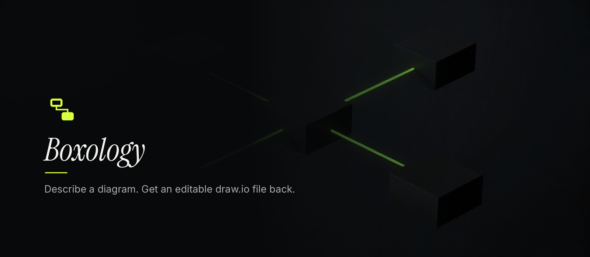
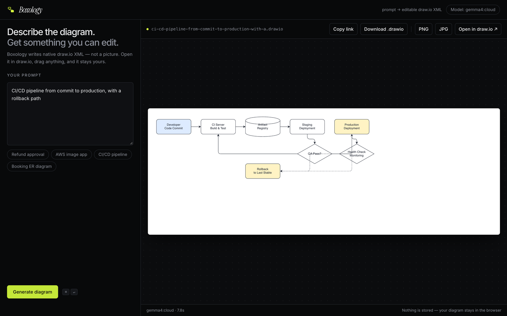
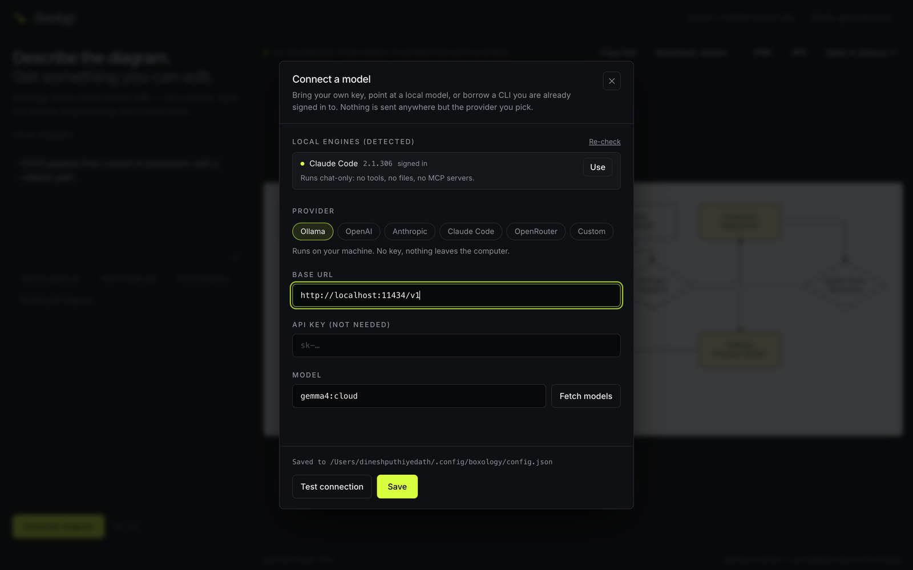

# Boxology: Describe a Diagram, Get an Editable draw.io File

**Boxology turns one sentence into a real draw.io diagram: native `.drawio` XML
you can open in draw.io, rearrange, and keep.** It runs on your own machine,
works with the model you already pay for, and has no account, no database and no
Boxology server.

It is a tool for the first draft of a diagram, not a replacement for a diagram
editor. You describe what you want, get a file, and edit it where you would have
edited it anyway.

<p align="center"></p>

> **Status:** early (0.1.0). The local host is the configuration that gets used;
> the Cloudflare Worker path is supported, but it needs extra protection before
> it is public. See [Known limitations](#known-limitations).

## Contents

- [What it does](#what-it-does)
- [Why Boxology](#why-boxology)
- [Quick start](#quick-start)
- [Using Boxology](#using-boxology)
- [Connecting a model](#connecting-a-model)
- [Architecture](#architecture)
- [Project layout](#project-layout)
- [Security model](#security-model)
- [Privacy](#privacy)
- [Known limitations](#known-limitations)
- [Contributing](#contributing)
- [License](#license)

## What it does

- **Editable output, not a picture.** Every result is draw.io XML built from standard shapes and real connectors. The `.drawio` download opens in the desktop or web editor, and **Open in draw.io** carries the same diagram to the web editor.
- **A live preview.** The returned XML is rendered by the vendored draw.io viewer, sized to the diagram's own bounds, so the panel shows what the file contains.
- **Any model.** OpenAI, Anthropic, OpenRouter, any OpenAI-compatible endpoint (Ollama, LM Studio, vLLM), or a signed-in Claude Code CLI. Providers are switched in settings, without a restart.
- **Keys stay on disk.** The API key lives in a local config file and is never returned to the browser. It is sent to the provider you picked and nowhere else.
- **PNG and JPEG export in the browser.** The same viewer renders the diagram again on an offscreen canvas, so getting a picture never uploads the diagram to a third party.
- **One core, two hosts.** A single `(request, env) => Response` handler runs on a local Node server and on Cloudflare Workers.

## Why Boxology

Most "describe a diagram" tools give you an image. An image is a dead end the
moment the diagram has to change, and diagrams change. draw.io files are XML,
they open in a free editor that plenty of teams already use, and they stay
editable for as long as you keep them. Boxology is a short path from a sentence
to that file.

The other half is where it runs. Diagram prompts often name internal systems,
so the default is a loopback server, a key file on your disk, and no telemetry.
Point it at Ollama or a CLI you are already signed in to and the prompt does not
leave the machine at all.

## Quick start

Pick where you want it to run:

| | Local app | Cloudflare Worker | Development checkout |
|---|---|---|---|
| **For** | one person on a laptop | a link you can share, with config from bindings | working on Boxology itself |
| **Needs** | [Bun](https://bun.sh), Node 20+, one model | a Cloudflare account, `wrangler login`, an API key | the same as local |
| **Status** | 0.1.0, the main path | supported; config is read-only; protect it before sharing | |
| **Guide** | [below](#run-it-locally) | [Deploying to Cloudflare](#deploying-to-cloudflare) | [Development checkout](#development-checkout) |

A **model** is whatever answers the prompt: a local Ollama model, an
OpenAI-compatible endpoint, Anthropic, OpenAI, or a coding CLI you are already
signed in to. The settings dialog shows what is available and why not.

### Run it locally

Requires [Bun](https://bun.sh) to build and Node 20+ to run. The built app has
no runtime dependencies.

```bash
git clone https://github.com/ShanthiStream/boxology
cd boxology
bun install
bun run build        # tsc + vite + server bundle → dist/
bun run start        # http://127.0.0.1:8787, opens your browser
```

On first launch the settings dialog opens. Pick a provider, paste a key (or
point at Ollama and skip the key), hit **Fetch models**, then **Test
connection** before saving. If `claude` is installed and signed in, Boxology
lists it as a local engine and you can use it without a key at all.

`npm install -g .` inside the clone puts the `boxology` command on your `PATH`;
the flags below assume that. Boxology is not on npm yet. When it is,
`npx boxology` will do the same thing without the clone.

```bash
boxology --port 9000             # different port
boxology --config ./cfg.json     # different config file
boxology --no-open               # do not launch a browser
boxology --help
BOXOLOGY_CONFIG=./cfg.json boxology   # same thing, env form
```

The server binds to loopback only. The draw.io viewer and both fonts are
vendored and served from the app's own origin, so preview and PNG/JPEG export
work offline and make no third-party requests. Only the model call leaves the
machine.

Prefer a single file to a clone? `bun run package` builds an installable
tarball:

```bash
bun run package
npm install -g ./release/boxology-0.1.0.tgz
boxology
```

### Install as an app window

Chrome and Edge can install the running app as a window with its own Dock or
taskbar icon and no tab strip: **Install Boxology** in the address bar, or
⋮ → Cast, save and share → Install page as app. It still talks only to
`127.0.0.1`. In Safari, use File → Add to Dock.

### Deploying to Cloudflare

The Wrangler config deliberately has **no `account_id`**, so it deploys to
whichever account you authenticate as. Config comes from bindings here, so
`/api/config` is read-only (`canWrite: false`) and `PUT` returns `405`.

```bash
# 1. Point at the target account (interactive, or token-based for CI)
wrangler login
# or:
export CLOUDFLARE_API_TOKEN=...
export CLOUDFLARE_ACCOUNT_ID=...

# 2. Store the key as a secret, never in wrangler.jsonc
wrangler secret put LLM_API_KEY

# 3. Ship it
bun run deploy
```

Non-secret defaults (`LLM_PROVIDER`, `LLM_MODEL`) live in `wrangler.jsonc`. To
use a different provider in production, edit those vars or override per
environment with `wrangler deploy --var LLM_PROVIDER:anthropic`.

You get `https://boxology.<your-subdomain>.workers.dev`. The subdomain is free
and yours to choose. A custom domain is optional and costs whatever the
registrar charges; Cloudflare Registrar sells at cost, around $10/year for a
`.com`.

#### Before it's public

The Worker has a **best-effort per-isolate rate limit** (12 requests per minute
per IP). Isolates are recycled and multiplied freely, so this is a speed bump,
not a quota. Anyone who finds the URL can spend your tokens. Add a Cloudflare
**WAF rate-limiting rule** on `/api/generate` before sharing the link, or put
Cloudflare Access in front of it.

### Development checkout

For UI work, `bun run dev` serves on `:5173` with hot reload, but expects the
Cloudflare-style host. To iterate against the local host, rebuild and restart:

```bash
bun run build:ui && bun run build:server
bun run start
```

`bun run typecheck` checks the TypeScript. `bun run ref` rebuilds the embedded
draw.io XML reference from `shared/xml-essentials.md` after that file changes.

## Using Boxology



1. **Describe the diagram.** One or two sentences work better than a paragraph. Name the parts, say what connects to what, and mention the shape if it matters (flowchart, ER diagram, swimlanes). The prompt is capped at 4,000 characters.
2. **Pick a model.** The header shows the current one; click it to change. Ollama and Claude Code need no key. See [Connecting a model](#connecting-a-model).
3. **Generate.** Press **Generate diagram** or `⌘/Ctrl + Enter`. A typical diagram takes a few seconds; the request is one model call with the official draw.io XML rules in the system prompt.
4. **Check the preview.** The panel renders the returned XML with the real draw.io viewer, at the diagram's own size rather than the pane's, and scrolls when the diagram is larger than the pane. The floating **− / 100% / +** control in the corner zooms between 25% and 400%; the percentage shows the current scale and clicking it returns to 100%. The filename above it is derived from your prompt. If the model returned broken XML, the repair pass in `worker/xml.ts` fixes the common cases; if it still fails, you get an error instead of an empty canvas.
5. **Edit it.** **Open in draw.io** sends the diagram to the editor in the URL fragment, so nothing is uploaded on the way. **Copy link** copies the same fragment. From there the file is yours to edit, and Boxology is out of the picture.
6. **Download.** `.drawio` for the file, PNG or JPG for a picture. Both images render in the browser from the vendored viewer, at 2× and cropped to the diagram.
7. **Nothing is stored.** No history, no drafts, no account. If you close the tab without downloading, the diagram is gone.

## Connecting a model

Use the settings dialog, or set four environment variables (`LLM_PROVIDER`,
`LLM_BASE_URL`, `LLM_API_KEY`, `LLM_MODEL`). `LLM_BASE_URL` accepts anything
that speaks the OpenAI chat-completions shape.

| Provider | `LLM_PROVIDER` | `LLM_BASE_URL` | `LLM_MODEL` |
|---|---|---|---|
| OpenAI | `openai` | `https://api.openai.com/v1` | `gpt-4.1-mini` |
| Anthropic | `anthropic` | — | `claude-sonnet-4-5` |
| OpenRouter | `openai` | `https://openrouter.ai/api/v1` | `anthropic/claude-sonnet-4.5` |
| Ollama (local) | `openai` | `http://localhost:11434/v1` | `qwen2.5-coder:14b` |
| LM Studio | `openai` | `http://localhost:1234/v1` | whatever you loaded |
| Claude Code (CLI) | `claude-cli` | — | `sonnet`, `opus`, `haiku` or a full id |

Local endpoints are detected by hostname and don't require a key, and
`claude-cli` never takes one. Models that are strong at structured XML (Claude,
GPT-4.1, Qwen2.5-Coder) produce noticeably better diagrams than small chat
models.



### Local CLI engines

If you already pay for a coding CLI, you already have a model. Boxology looks
for one when it starts, and a signed-in `claude` shows up in the settings dialog
as **Claude Code**, with the same login and quota you use in a terminal and no
key to paste.

Detection is cached for 15 seconds and never fails a request: `claude --version`
and `claude auth status --json` run side by side with a 12-second cap each. Only
`loggedIn` is read from that payload; the account email and organisation never
reach the browser, and a probe that times out reports "unknown", not "broken".

A generation spawns the CLI once, chat-only:

```bash
claude -p --output-format text \
  --tools "" --strict-mcp-config --disable-slash-commands \
  --permission-mode dontAsk \
  [--model MODEL] [--append-system-prompt SYSTEM]
```

- The prompt goes in on **stdin**, never argv, so it stays out of `ps` and shell history.
- The working directory is the OS temp dir, so a `CLAUDE.md` in whatever project you have open cannot steer a diagram.
- If the CLI does not understand one of those flags it refuses to start. That is the safe failure; the alternative is a run with tools enabled.

Installed somewhere unusual? `PATH` wins, then `~/.local/bin`,
`~/.npm-global/bin`, `~/.claude/local`, `/usr/local/bin` and
`/opt/homebrew/bin` are **appended** (only if they exist), because a
GUI-launched app inherits a much smaller `PATH` than your shell. Add your own
directory with a colon-separated list:

```bash
BOXOLOGY_EXTRA_PATH=/opt/tools/bin bun run start
```

Local engines exist only on the local host: the runner is injected through
`Env`, and a Cloudflare deployment has no `node:child_process`, so `claude-cli`
is not selectable there. Only Claude Code is wired up today;
`server/engines.ts` keeps engines as a table, so adding another CLI is an entry
plus its flag set rather than a new code path.

### Where your key lives

`~/.config/boxology/config.json` (respects `XDG_CONFIG_HOME`; on Windows
`%APPDATA%\boxology\config.json`), written `0600` inside a `0700` directory.

```json
{
  "version": 1,
  "provider": "openai",
  "baseUrl": "http://localhost:11434/v1",
  "apiKey": "sk-…",
  "model": "qwen2.5-coder:14b"
}
```

The key is never returned to the browser; `GET /api/config` reports only
`hasApiKey: true`. Leaving the key field blank in the dialog keeps the saved
one, but only while the provider stays the same: a key belongs to one provider
and is dropped when you switch. A CLI provider stores no key and no base URL at
all.

## Architecture

```text
prompt ──▶ handler ──▶ model (provider-agnostic) ──▶ draw.io XML
                                                       │
                          live preview ◀───────────────┤  rendered in the browser
                          #R link      ◀───────────────┤  Open in draw.io
                          .drawio file ◀───────────────┤  download
                          PNG / JPEG   ◀───────────────┘  in-browser export
```

`worker/index.ts` is a plain `(request, env) => Response` handler. Cloudflare
runs it directly, and `server/local.ts` runs the same function on `node:http`
for local use.

| Piece | File | Notes |
|---|---|---|
| HTTP API | `worker/index.ts` | Routes below |
| Model adapter | `worker/llm.ts` | OpenAI-compatible + Anthropic branches |
| Request guard | `worker/guard.ts` | Host/Origin checks for the local host |
| Config store | `server/config.ts` | `0600` JSON file, local host only |
| Local engines | `server/engines.ts` | CLI detection, bounded runs, error normalisation |
| Local host | `server/local.ts` | `node:http`, static files, loopback bind |
| npm launcher | `bin/boxology.mjs` | `npx boxology` / global install entry |
| Settings UI | `src/components/SettingsDialog.tsx` | Provider presets, detected engines, test |
| Prompt | `worker/prompt.ts` | Inlines the official draw.io XML rules |
| Output repair | `worker/xml.ts` | Fences, bare `&`, dangling edges, markup in attributes |
| URL/file encoding | `worker/drawio.ts` | `#R` fragment + `.drawio` wrapper |
| Preview | `src/lib/viewer.ts` | `viewer-static.min.js` + GraphViewer |
| Image export | `src/lib/export.ts` | Offscreen render → `` → canvas → PNG/JPEG |

`shared/xml-essentials.md` is vendored from
[jgraph/drawio-mcp](https://github.com/jgraph/drawio-mcp) (Apache-2.0) and
compiled into `worker/reference.ts`. After updating it, run `bun run ref`.

### Details that are easy to get wrong

1. **Compression order.** draw.io's `#R` fragment is
   `encodeURIComponent(xml)` → raw deflate → base64 → URL-encoded. Compressing
   the raw XML instead produces a well-formed link that renders an empty canvas.
   Verified byte-for-byte against the reference Python implementation in
   `drawio-mcp/project-instructions`.
2. **GraphViewer takes a DOM element, not a string.** `init` calls
   `xml.ownerDocument`; passing the XML string throws an `XMLSerializer` error,
   which most examples online get away with only because they use the
   `data-mxgraph` attribute path.
3. **The viewer caps zoom-in at 100%.** `auto-fit` can only shrink, so a small
   diagram lands in the corner of a large canvas. The preview sizes its sheet to
   the diagram's measured bounds instead, and lets the pane scroll when the sheet
   is bigger than the space available — clamping the sheet to the pane would put
   the rest of a large diagram behind `overflow: hidden`, where nothing can reach
   it. The zoom control calls `graph.zoomTo`, which is *not* capped, and leaves
   `centerZoom` off so a step scales from the origin: every scale then lays out
   exactly like 100%, which is what lets the sheet be sized as
   `(bounds + 2 × border) × zoom` and stay a true page.
4. **HTML in an XML attribute kills the whole file.** Models happily emit
   `value="Pay<br>Now"` with `html=1` in the style. XML requires `&lt;br&gt;`,
   and draw.io rejects the entire diagram otherwise. `sanitize` repairs markup
   inside attribute values only, leaving tags and text alone.

### PNG and JPEG export

The preview has **PNG** and **JPG** buttons. Both render in your browser: the
diagram is drawn again by the same `GraphViewer` into an offscreen container
sized to the diagram, then rasterised through an `` and a canvas. draw.io's
own export is an editor action on their servers, and uploading the diagram just
to get a picture of it would contradict the rest of the app.

- **Offscreen, at 1:1.** Exporting the on-screen preview would bake in the fact
  that the pane only shows the top-left slice of a diagram too big for it. The
  offscreen render is always the diagram's own size, then 2× for sharpness.
- **Tight crop.** Bounds come from the geometry, not the canvas, so a diagram that spilled past its sheet still exports whole. HTML labels are measured through the shape they sit in; draw.io parks each `<foreignObject>` at `x=-9879` to centre text, and measuring that would produce a canvas the size of a football pitch.
- **Light colours on white.** draw.io writes label colours as `light-dark(light, dark)`. A detached SVG has no colour scheme, so the light value is committed and both formats get a white page.
- **No editor furniture.** Collapse/expand handles are stripped; they belong to editing, not to the picture.
- **Bounded.** Output is capped at 24 megapixels, because browsers refuse very large canvases.

### API

| Route | Purpose |
|---|---|
| `POST /api/generate` | `{ prompt }` → XML, `#R` payload, viewer/editor URLs, `.drawio` file |
| `POST /api/models` | Draft settings → model ids (nothing saved) |
| `POST /api/test` | Draft settings → one-token round trip, latency included |
| `GET /api/config` | Effective config, key redacted, plus detected local engines |
| `PUT /api/config` | Save config, local host only (`405` elsewhere) |
| `GET /api/health` | Liveness plus whether the current config resolves |

`/api/models` and `/api/test` take a draft `{ provider, baseUrl, apiKey, model }`
so settings can be proved before they are written. A missing key falls back to
the saved one, which is why "Test connection" works without retyping it.

## Project layout

- [src/](src) — React UI: prompt panel, preview pane, settings dialog, export.
- [worker/](worker) — request handler, model adapters, prompt, XML repair, draw.io encoding.
- [server/](server) — `node:http` host, config store, local CLI engines.
- [shared/](shared) — vendored draw.io XML rules, compiled into the worker.
- [bin/](bin) — the `boxology` launcher.
- [scripts/](scripts) — icon, banner and reference generators.
- [docs/](docs) — the banner and screenshots used above.

## Security model

A server on `localhost` is reachable by every page you have open, so binding to
loopback is not enough on its own:

| Risk | Control | Where |
|---|---|---|
| LAN exposure | binds `127.0.0.1` only, never `0.0.0.0` | `server/local.ts` |
| DNS rebinding | `Host` must be `127.0.0.1`, `localhost` or `[::1]` | `worker/guard.ts` |
| CSRF / token theft | `Origin`, when present, must be loopback | `worker/guard.ts` |
| Key on disk | `0600` file in `0700` dir, re-chmod'd on write | `server/config.ts` |
| Key in responses | never serialized; only `hasApiKey` | `worker/index.ts` |
| CLI as a model | chat-only run, prompt on stdin, cwd is the temp dir | `server/engines.ts` |
| Runaway spend | 12 requests/minute per IP | `worker/index.ts` |

Without the `Host` check, `evil.com` could resolve to `127.0.0.1` and read your
config through the user's browser. Without the `Origin` check, any page could
`POST /api/generate` and spend your tokens. Both are rejected with `403`.

## Privacy

No database, no storage, no accounts. A diagram exists in the HTTP response and
in your browser. `Open in draw.io` carries it in the URL **fragment**, which
browsers never transmit to a server.

The prompt and the generated diagram are sent to whichever model provider you
configure; that is inherent to generating them. Everything else is local: the
draw.io viewer and both fonts are vendored and served from the app's own origin,
so preview and PNG/JPEG export make no third-party requests. Nothing is uploaded
anywhere. With Ollama or a CLI engine, no diagram ever leaves the machine.

A few stencil libraries (AWS/Azure icons, math typesetting) are not vendored.
They are fetched from `viewer.diagrams.net` only if a diagram actually uses
them. Boxology's own output is text and standard shapes, which are inline.

## Known limitations

- **The preview is a render, not an editor.** To move a box or rename a lane, open the diagram in draw.io. The preview is there to tell you whether the model understood the prompt.
- **Nothing is saved.** No history, no drafts, no recovery. Closing the tab loses the diagram unless you downloaded it or opened it in draw.io.
- **Single user, no authentication.** The local host is designed for one person on one machine. Keep it on loopback; a public proxy in front of it would expose the config endpoints.
- **The rate limit is best-effort.** 12 requests per minute per IP, kept in memory per isolate. On Cloudflare that is not a spending limit; add a WAF rule or Cloudflare Access.
- **Cloudflare config is read-only.** Settings come from bindings, so the dialog can test a model but not save one.
- **CLI engines are local-only and Claude-only.** `claude-cli` is not selectable on Cloudflare, and no other coding CLI is wired up yet.
- **Model quality varies.** Small chat models produce invalid XML more often. The repair pass handles the common failures, not a model that ignores the shape of the request.
- **Some stencils load remotely.** AWS/Azure icons and math typesetting come from `viewer.diagrams.net` when a diagram uses them.
- **No automated tests.** The checks that exist are manual, against Ollama and hosted models.
- **Not on npm yet.** Install from the clone, or build the tarball with `bun run package`.

## Contributing

Issues and pull requests are welcome. Keep the README in step with behaviour,
and if you change the prompt or the XML repair path, run it against a real
provider before opening the PR. A small Ollama model is a good stress test
because it gets things wrong in interesting ways.

## License

Apache-2.0. See [LICENSE](LICENSE) and [NOTICE](NOTICE). The draw.io XML
guidance is derived from JGraph's `drawio-mcp`, and the notice records that.

"draw.io" and "diagrams.net" are trademarks of JGraph Ltd. Boxology is an
independent tool that reads and writes the draw.io file format; it is not
affiliated with or endorsed by JGraph. Keep their marks in descriptive text
("opens in draw.io") and out of the product name.
